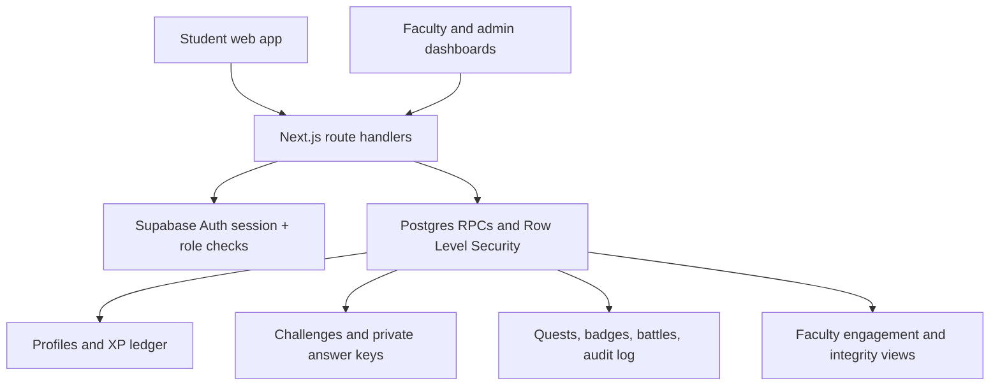

# LearnQuest Game Design (submission brief)

## Design promise

LearnQuest rewards repeatable learning behaviours—not idle clicks or raw leaderboard rank. XP is a motivational layer and never changes official marks. No XP is removed for absence. Every non-quiz award must reference a verifiable source record and is idempotent, limited by configurable rules, and written to an audit ledger.

## Starting points economy

| Verified action | XP | Limit / evidence |
|---|---:|---|
| Attend a class | 10 | Per class; official attendance record required |
| Submit classwork/homework on time | 20 | Per assignment submission |
| Complete daily quiz | 15 | Once per day in the intended daily-quiz workflow |
| Correct quiz answer | +5 | Maximum 5 correct-answer bonuses per daily quiz |
| Coding problem | 10 / 20 / 40 | Easy / medium / hard; verified provider submission; max 10/day |
| Club activity | 25 | Per verified club day |
| 7-day streak | 50 | Once when a streak first reaches 7 days |
| Accepted peer answer | 15 | Accepted discussion answer; max 3/day |

Administrators can change points, enabled state and daily limits without a code change. The `award_verified_xp` RPC requires staff authorization, a non-empty source reference, an enabled rule, campus scope, a daily-limit check, and an idempotency key. Quiz XP is awarded by the existing server-side grading RPC; the new trigger records its ledger entry. A streak trigger counts distinct dates and can consume the small freeze allowance rather than treating multiple quizzes in one day as multiple streak days.

## Progression and fairness

- Levels advance at 100 XP per level.
- Quests and badges are seeded to support first challenge, topic exploration, seven-day streak, improvement, and team participation. Improvement-based recognition lets a learner improve without being a top scorer.
- A student may opt out of identity display on leaderboards; the public display becomes “Anonymous learner” with no avatar. Their learning features and faculty visibility are unaffected.
- Weekly/monthly resets should be used for competitive seasons; the current leaderboard is an all-time XP view and does not yet implement weekly league promotion/relegation.
- Team-battle records support scheduled/live/completed events and scores. Real-time fanout/scoreboard updates require a configured realtime deployment and must be load-tested before being represented as production-ready.

## Anti-gaming controls

1. **Quiz replay:** one attempt per challenge is enforced by the existing database uniqueness/RPC flow; a source-reference unique index prevents duplicate ledger awards.
2. **Quiz spam:** challenge attempt restrictions apply; XP rules include daily limits. A true “one daily quiz across all challenges” policy still requires the daily challenge to be explicitly designated and enforced in the quiz submission RPC.
3. **Fake attendance/club/coding:** never call the verified-award RPC until the official source has been checked; no provider integrations are configured in this submission.
4. **XP spikes:** XP ledger, audit log and learning flags allow staff investigation. The UI shows available flags; automated anomaly thresholds still require calibration on real pilot data.
5. **Answer sharing:** option positions are shuffled for each fresh quiz load and the exact displayed order is snapshotted. This is friction, not a complete collusion detector; answer-pattern detection requires a real cohort and threshold validation.

## Architecture

## Privacy and retention

Authentication and learning records live in the configured Supabase project. The student-facing leaderboard honors the anonymity preference. Faculty/admin access is campus/role scoped by database policies. Uploaded avatars use the `profile-avatars` storage bucket and signed URLs. Do not import real student data without institutional approval and consent. Set and publish a retention period with MSOT before a real pilot; this repository does not invent an institutional retention policy. Do not commit `.env.local`, service-role keys, student exports, or real learner recordings.
